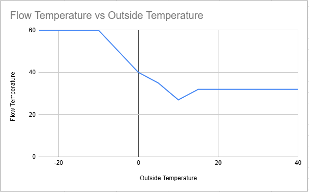
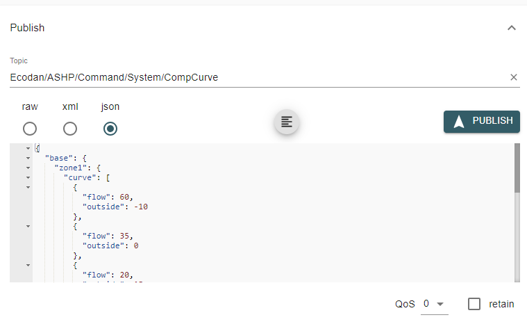
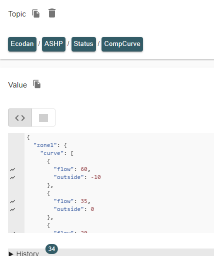
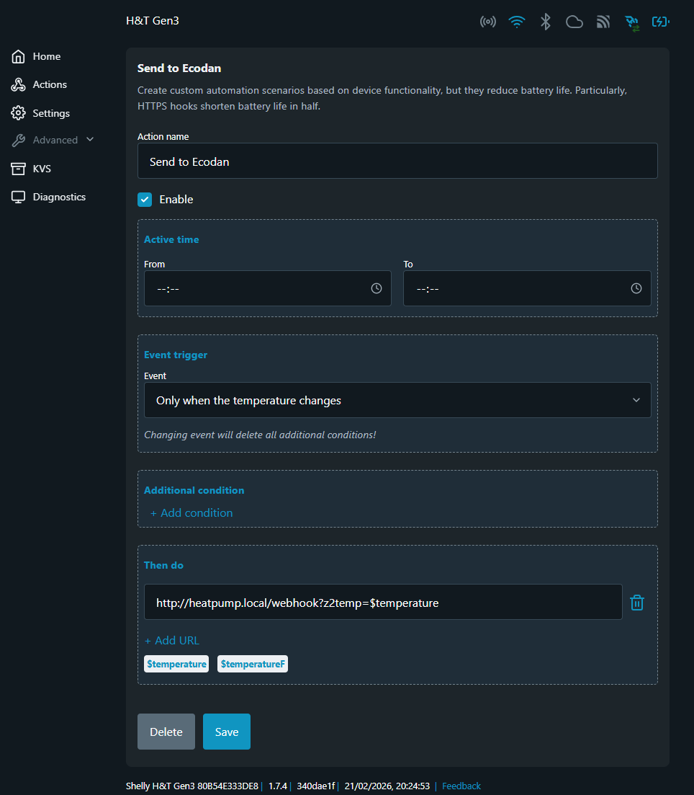
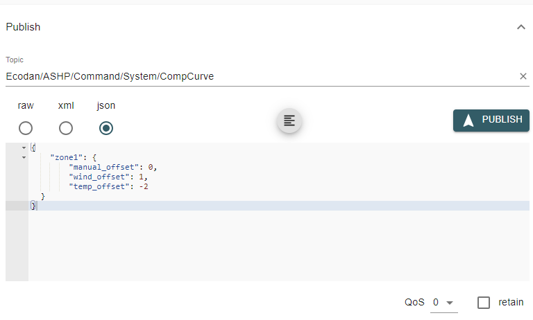
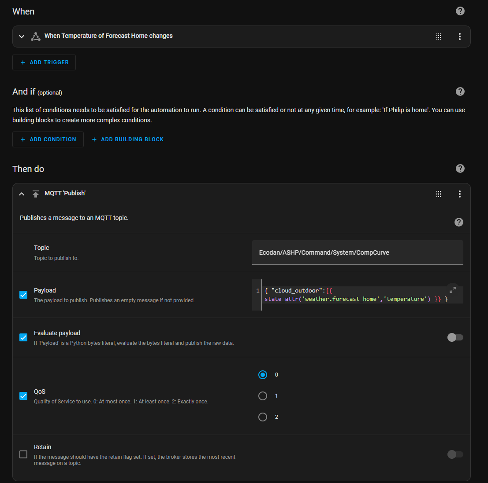
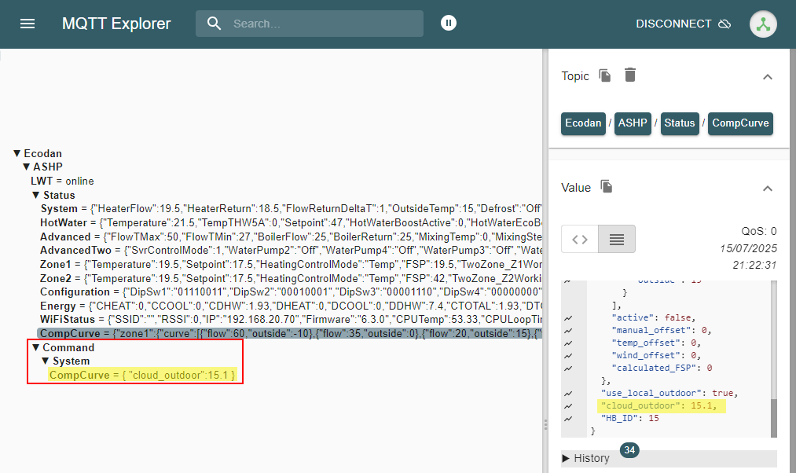

# Using the onboard Compensation Curve


### About
The software has the ability to store a custom compensation curve onboard - this overcomes some limitations with the Ecodan and allows advanced features to be input.

* The Ecodan Main Room Controller (MRC) has the ability to design a curve with a maximum of 3 points, there is no limit to the number of points which can be sent to the CN105 Ecodan Bridge device.
* There is also no ability to add an +/- offset to the current curve remotely, only by adjusting on the the controller screen. By moving the curve onto the CN105 Ecodan Bridge, an offset can be adjusted remotely.
* The Ecodan uses the Outside Air Temperature (OAT) sensor located on the back of the outdoor unit, this sensor can be influenced by the likes of direct sunlight. By moving the curve onto the CN105 Ecodan Bridge it's possible to use another temperature source to determine the flow temperature.
* The Ecodan cannot automatically adjust for other influencing factors, such as heat loss due to wind or solar gain. By moving the curve onto the CN105 Ecodan Bridge it's possible to automate the offset when conditions may influence the building.


The device can continue to calculate and input to the curve if the connection is broken.


### How to Design, Modify and Operate

The Ecodan is to be placed in Fixed Flow mode, as the value is calculated by the device it will then adjust the flow temperature setpoint automatically which recreates the method the Ecodan uses.
By activating the onboard compensation curve, if not already in Fixed Flow the software will change your Ecodan to this mode.


### MQTT Topics

The MQTT topics are no longer fixed to `Ecodan/ASHP/`. They start with the **Primary MQTT Base Topic** you set on the bridge's setup page. In this document that prefix is written as `<base topic>/`, so replace it with your own, for example:

| Base Topic set on the bridge | `<base topic>/Command/System/CompCurve` becomes |
|--------|---------|
| Ecodan/ASHP | Ecodan/ASHP/Command/System/CompCurve |
| ASHP | ASHP/Command/System/CompCurve |

If you use a second MQTT server, the same topics are available under its **Secondary MQTT Base Topic**.


### Designing a Curve

Similar to the main controller screen, there is a flow temperature and an outside temperature:


The corrosponding data points are:

| Outside Temperature (C) | Flow Temperature (C) |
|--------|---------|
| -10 | 60 |
| 0 | 40 |
| +5 | 35 |
| +10 | 27 |
| +15 | 32 |


The design for Zone1 can be different to Zone2, if your system has suitable Complex 2 Zone hardware (i.e. mixing) to support different flow temperatures on different zones

The Curve is recorded and sent as JSON to be saved on the device, using the example above, the JSON would look like so:

```javascript
{
  "base": {
    "zone1": {
      "curve": [
        {
          "flow": 60,
          "outside": -10
        },
        {
          "flow": 35,
          "outside": 0
        },
        {
          "flow": 27,
          "outside": 10
        },
        {
          "flow": 32,
          "outside": 15
        }
      ]
    },
    "zone2": {
      "curve": [
        {
          "flow": 60,
          "outside": -10
        },
        {
          "flow": 35,
          "outside": 0
        },
        {
          "flow": 27,
          "outside": 10
        },
        {
          "flow": 32,
          "outside": 15
        }
      ]
    }
  }
}
```


### Programming or Modifying the Curve (Base)

Using MQTT Explorer, we can send our design, in JSON to the topic: `<base topic>/Command/System/CompCurve`


```javascript
{
  "base": {
    "zone1": {
      "curve": [
        {
          "flow": 60,
          "outside": -10
        },
        {
          "flow": 35,
          "outside": 0
        },
        {
          "flow": 20,
          "outside": 15
        },
        {
          "flow": 10,
          "outside": 20
        }
      ]
    },
    "zone2": {
      "curve": [
        {
          "flow": 60,
          "outside": -10
        },
        {
          "flow": 35,
          "outside": 0
        },
        {
          "flow": 20,
          "outside": 15
        }
      ]
    }
  }
}
```




You can verify the curve has been saved, looking at the `<base topic>/Status/CompCurve` topic:



### Enable or Disable the Mode
In JSON to the topic: `<base topic>/Command/System/CompCurve`

```javascript
{   
    "zone1": {
        "active": true
    }
}
```

### Using Room Influence, Setpoint & Temperatures

It is possible to send Room Influence values, which will influence the flow setpoint based on the difference between current temperature and setpoint of a room sensor.
You can use both Local Ecodan measurements and External temperature sensors & setpoint.

For "local" system temperature setpoint and temperature feedback, e.g. from the Main Room Controller (MRC) or Wireless Controllers set "use_local_tsensor": true and the setpoint and current temperature will be used
For "remote" system temperature setpoint and temperature feedback, e.g. from another sensor is default "use_local_tsensor": false


In JSON to the same topic: `<base topic>/Command/System/CompCurve`

```javascript
{   
    "zone1": {
      "room_influence_active": true,
      "use_local_tsensor": false,
      "room_setpoint": 21,
      "room_temperature": 19.3,
  }
}
```

Publish Internal Temperatures from Extenal Sensors on change with Automations:


```yaml
alias: Publish Zone 1 Temperature from HA to Bridge
description: ""
triggers:
  - trigger: state
    entity_id:
      - sensor.bedroom_temperature
conditions: []
actions:
  - action: mqtt.publish
    metadata: {}
    data:
      evaluate_payload: false
      qos: "0"
      topic: <base topic>/Command/System/CompCurve  # replace <base topic> with your own
      payload: >-
        { "zone1": {"room_temperature": {{ states('sensor.bedroom_temperature')|float(0) }} }}
mode: single
```


Additionally, you can by-pass Home Assistant automations if your temperature sensor supports sending HTTP requests (e.g. Shelly devices with Automations) directly.
Sending the payload to the following endpoints, for either current temperature zXtemp or zXsetpoint:

```http://heatpump.local/webhook?z1temp=22.1```
```http://heatpump.local/webhook?z1setpoint=22.0```
```http://heatpump.local/webhook?z2temp=22.1```
```http://heatpump.local/webhook?z2setpoint=22.1```



### AC Remote Thermostat Reading
#For AC Users, you can send "Remote Temperature Sensor" probe readings from 3rd party thermostats, e.g. Shelly H&T to act as your current room temperature within HA or directly using webhooks:

```http://heatpump.local/webhook?actemp=22.1```


### Sending Offsets & Outdoor Temperatures

In a similar way, you can make modification to the Offsets (+/- of the calculated Flow Setpoint) by sending JSON: 

Up to three Offsets exist, all act in the same way by adding or subtracting to the Flow Setpoint calculated on the base curve.
* Manual Offset is intended for users to adjust via a Dashboard
* Wind Offset is intended if you require additional heat at higher windspeed, usually calculated from an automation
* Temp Offset is intended if you reduce flow when solar gain is high, usually calculated from an automation


In JSON to the same topic: `<base topic>/Command/System/CompCurve`

```javascript
{   
    "zone1": {
        "manual_offset": 0,
        "wind_offset": 1,
        "temp_offset": -2
  }
}
```

It might be helpful to add a number entity to configuration.yaml, to adjust this offset from within HA, like so:

```yaml
mqtt:
  number:
    - name: "Zone 1 Compensation Curve Offset"
      state_topic: "<base topic>/Status/CompCurve"            # replace <base topic> with your own
      value_template: "{{ value_json.zone1.manual_offset }}"
      command_topic: "<base topic>/Command/System/CompCurve"  # replace <base topic> with your own
      command_template: >
        {
          "zone1":
            {
              "manual_offset": {{ value }} 
            }
        }
      unit_of_measurement: "°C"
      min: -5
      max: 5
      step: 0.5
      unique_id: "ecodan_ashp_z1_comp_curve_offset"
```





The value of Outside Air Temperature (OAT) used in the curve calculation by default is from the sensor located on the unit itself, however you can choose to use your own value for Outdoor Air Temperature in the following way:


In JSON to the same topic: `<base topic>/Command/System/CompCurve`

Set Use Local Outdoor as False:
```javascript
{   
    "use_local_outdoor": false
}
```

Provide a regularly updating Outdoor Air Temperature Value and ensure it is published when home assistant starts for example:
```javascript
{   
    "cloud_outdoor": 14.3
}
```    



```yaml
alias: Publish Temperature from HA Weather to Bridge
description: ""
triggers:
  - trigger: state
    entity_id:
      - weather.forecast_home
    attribute: temperature
conditions: []
actions:
  - action: mqtt.publish
    metadata: {}
    data:
      evaluate_payload: false
      qos: "0"
      topic: <base topic>/Command/System/CompCurve  # replace <base topic> with your own
      payload: >-
        { "cloud_outdoor":{{ state_attr('weather.forecast_home','temperature')
        }} }
mode: single
```





If the MQTT connection is lost, the Bridge device will revert to using the local sensor.

NOTE: The FTC may still use the OAT sensor in it's processes, such as defrosting or frequency limiting - this value cannot influence those actions but only determining a Flow Temperature


### Short Cycle Protection (Active Control)

The FTC stops the outdoor unit as soon as the flow temperature is more than **2.0C above the flow setpoint (FSP)**, and the flow and return sensors only read in 0.5C steps. The compressor also has a minimum (floor) frequency, so in mild weather it can produce more heat than the emitters can pass. The flow then rises, the FTC stops the outdoor unit, and it starts again a few minutes later: a short cycle.

Short Cycle Protection (called *Active Control* in the MQTT topic names) works alongside the Onboard Compensation Curve to prevent this. It has five parts:

1. **Anti-stop flow following (heating)** - moves the Zone 1 flow setpoint up and down so it trails the actual flow, keeping it inside the FTC's 2.0C stop limit. It is aware of the compressor's floor frequency
2. **Anti-stop flow following (cooling)** - the same idea in 0.5C steps while cooling
3. **DHW flow following** - keeps the flow setpoint matched to the flow temperature while hot water is being heated
4. **Post DHW letdown** - brings the flow temperature smoothly back down to the curve after hot water
5. **Short cycle lockout** - if short cycling still happens, temporarily prohibits space heating and cooling

It only applies to Air to Water heat pumps (FTC), and all flow setpoint changes are made to **Zone 1**.


#### Turning it on or off

Use the Home Assistant **Short Cycle Protection** switch, or send `1` (on) or `0` (off) to the topic `<base topic>/Command/System/ActiveControl`. Service code 992 toggles it. The setting is saved and survives a restart. Turning it off while a lockout is running ends the lockout straight away.


#### Settings

These are sent as JSON to `<base topic>/Command/System/CompCurve`, the same topic as the curve. They are saved on the bridge and survive a restart.

| Key | Default | Range | Description |
|--------|---------|---------|---------|
| max_flow_overshoot | 3 | 0 - 20 | The most the flow setpoint may be raised above its starting point (normally the curve) by anti-stop flow following. Can also be set in whole degrees with service codes 880 - 900 (880 = 0C, 883 = 3C) |
| floor_allowance | 0 (Off) | 0 - 15 | Only used when it is **greater** than max_flow_overshoot. While the compressor is at its learned floor frequency, the flow setpoint may follow up to the starting point + this value (never above the FTC's maximum flow temperature). 0 keeps the normal behaviour |
| room_stop_hyst | 0.5 | 0 - 3 | Ends a floor allowance run once the room temperature reaches the room setpoint + this value |
| fixedlockoutduration | 0 (Automatic) | minutes | Use a fixed short cycle lockout time instead of the automatic 10 - 20 minutes |

Example:

```javascript
{
    "max_flow_overshoot": 3,
    "floor_allowance": 6,
    "room_stop_hyst": 0.5,
    "fixedlockoutduration": 0
}
```

You can send any one of these on its own, for example `{"fixedlockoutduration": 30}`.


#### 1. Anti-stop flow following (heating)

**When it runs.** Once each time a full read of the FTC completes, while all of these are true:
* Short Cycle Protection is on
* The compressor is running in space heating, and Zone 1 is in Heating Flow (Fixed Flow) mode
* The Zone 1 flow setpoint is above 0
* The post DHW letdown is not running
* No earlier write to the FTC is still waiting to be sent

**Starting point.** Following starts from the flow setpoint the Compensation Curve has calculated for Zone 1 (or the setpoint you entered, if the curve is not active). If the setpoint is already above the curve when following starts, that is used instead. While following, the starting point moves **up** if the curve rises, but never down.

**Raising and lowering the setpoint.** The bridge aims to hold the flow setpoint **1.0C below the actual flow temperature**. Logged data showed the FTC increases the compressor frequency far more often when the flow is at or below the setpoint (30+ times an hour) than when it is 1.0C above it (under once an hour), so this keeps the compressor at a low, steady frequency as well as avoiding the 2.0C stop.

| Flow temperature minus flow setpoint | Action |
|--------|---------|
| 1.5C or more (getting close to the 2.0C stop) | **Raise**: setpoint = flow - 1.0C |
| Between 0.5C and 1.5C | **Hold**, no change |
| 0.5C or less, on **two reads in a row**, and the setpoint is above the starting point | **Lower**: setpoint = flow - 1.0C |

* The new setpoint is an absolute value, so it can move more than 0.5C in one write
* The setpoint is never lowered below the starting point, and never raised above the starting point + max_flow_overshoot (or the floor ceiling, see below)
* A new setpoint is only written if it differs from the current one by 0.25C or more, because each write to the FTC is disruptive. The two-read wait before lowering is for the same reason
* While following is active, the Compensation Curve keeps calculating every 5 minutes but does not write its value to the FTC

**Example** (curve setpoint 35C, max_flow_overshoot 3C, so the ceiling is 38C):

| Flow | Setpoint before | Flow - Setpoint | Action | Setpoint after |
|--------|---------|---------|---------|---------|
| 36.0 | 35.0 | 1.0 | Hold | 35.0 |
| 36.5 | 35.0 | 1.5 | Raise | 35.5 |
| 37.0 | 35.5 | 1.5 | Raise | 36.0 |
| 38.0 | 36.0 | 2.0 | Raise | 37.0 |
| 39.0 | 37.0 | 2.0 | Raise, reaches the ceiling | 38.0 |
| 39.5 | 38.0 | 1.5 | Would raise to 38.5, limited to the ceiling | 38.0 |
| 38.0 | 38.0 | 0.0 | First low read, wait | 38.0 |
| 37.5 | 38.0 | -0.5 | Second low read, lower | 36.5 |
| - | - | - | Compressor stops, hand back | 35.0 |

Once the ceiling is reached the setpoint cannot follow any further. If the flow keeps rising past ceiling + 2.0C, the FTC stops the outdoor unit as normal.

**Hand back.** When the compressor stops (not during a defrost), the bridge writes the Compensation Curve value back to the Zone 1 flow setpoint (or the setpoint you entered, if the curve is not active) and following ends. If the stop happened during a defrost, the hand back happens once the defrost has finished and the compressor is still stopped.


#### Floor-aware following (floor_allowance)

At its floor frequency the compressor cannot turn down any further, so the flow keeps rising until the emitters can pass the heat (typically a mean water temperature around 12 - 13C above the room). The normal ceiling stops the setpoint following that far, so the FTC cuts the outdoor unit. Setting floor_allowance above max_flow_overshoot lets the flow reach that balance point and run continuously instead.

* **At the floor:** the ceiling becomes starting point + floor_allowance, but no higher than the FTC's maximum flow temperature (it is never lower than the normal ceiling)
* **Leaves the floor mid-run:** if the setpoint is already above the normal ceiling, it is held where it is and not pulled down (pulling it down would itself stop the outdoor unit). It just stops rising
* **Room satisfied:** once the room temperature reaches room setpoint + room_stop_hyst, the run is ended. The setpoint goes back to the curve and the FTC stops the outdoor unit on its own 2.0C rule. This is held until the compressor next starts

The room temperature and setpoint come from the same place as Room Influence. With `"use_local_tsensor": true` set for zone1, the FTC's Zone 1 temperature and setpoint are used, otherwise the `room_temperature` and `room_setpoint` values you send. Those sent values are not saved, so after a restart the room-satisfied stop only works once they have been sent again. Without them, a floor run continues until the compressor stops by itself.

**Learning the floor frequency.** The floor depends on the outdoor temperature and differs between models (some compressors reduce to 16Hz), so the bridge learns it rather than assuming it:
* It records the lowest frequency held for **5 minutes**, ignoring the first **15 minutes** of each run, during space heating only and away from defrosts
* It is learned separately for each 1C band of outdoor temperature (from the FTC's own outdoor sensor, -20C to +20C)
* A band's floor is only trusted once it has been seen in **3 separate compressor runs**. If a colder band has a lower trusted floor, the lower value is used
* The table is saved on the bridge (at most every 10 minutes while learning) and survives a restart

Until a floor is trusted for the current outdoor temperature, following behaves as if floor_allowance was off.

| Service code | Action |
|--------|---------|
| 990 | Publish the learned table to `<base topic>/Status/AdvancedTwo` as `LastSvcReply`, in the format `[[outdoor C, floor Hz, runs seen], ...]` |
| 991 | Clear the learned table and start learning again |

Service codes are sent to `<base topic>/Command/System/Svc`.


#### 2. Anti-stop flow following (cooling)

While the compressor is running in cooling with Zone 1 in Cooling Flow mode, the setpoint is moved in fixed 0.5C steps:

| Condition | Action |
|--------|---------|
| Flow is more than 1.0C **below** the setpoint and still falling | Setpoint lowered by 0.5C, up to max_flow_overshoot in total (3C = 6 steps) |
| Flow is less than 0.5C below the setpoint, after it has been lowered | Setpoint raised by 0.5C (one step undone) |

The setpoint is handed back when the compressor stops, the same as for heating.


#### 3. DHW flow following

While hot water is being heated the flow temperature rises far above the heating setpoint. When the FTC switched back to space heating, the flow would be more than 2.0C above the setpoint and the outdoor unit would stop. To prevent this, every **30 seconds** during hot water the bridge sets the Zone 1 flow setpoint to the actual flow temperature.

Needs Zone 1 in Heating Flow mode and the Onboard Compensation Curve active for Zone 1 or Zone 2.


#### 4. Post DHW letdown

After hot water the flow temperature falls slowly. A setpoint held **above** the flow keeps the compressor working towards a target it cannot reach, so instead the bridge holds the setpoint **0.5C below** the actual flow. The FTC reduces the compressor frequency and the flow comes down towards the curve, while staying inside the 2.0C stop limit. Anti-stop flow following is paused while this runs.

Control is handed back to the Compensation Curve as soon as the flow is within 0.5C of the curve's flow setpoint (straight away if it already is when hot water ends), or after **15 minutes** at most. If hot water starts again, DHW flow following takes over.

It only starts if DHW flow following ran during that hot water run, and needs Zone 1 in Heating Flow mode with the Compensation Curve active for Zone 1.


#### 5. Short cycle lockout

**Detection.** The bridge times the gap between each compressor stop and the next, ignoring stops during a defrost. If the last two gaps add up to **less than 20 minutes** (more than 6 stops an hour), a short cycle is declared.

**Lockout.** The bridge puts the FTC into Server Control Mode and prohibits Zone 1 and Zone 2 heating and cooling. The hot water prohibit is left as it was, so hot water can still run. The globe symbol shows on the Main Room Controller while the lockout is active.

**Duration.** Automatic by default, from 10 minutes (last two gaps close to 0) to 20 minutes (last two gaps just under 20 minutes):

`lockout (minutes) = 10 + (last two gaps added together in seconds / 120)`

A fixedlockoutduration above 0 replaces this. When the time is up, or Short Cycle Protection is turned off, the previous Server Control Mode and prohibit settings are put back and the compressor history is cleared.

**Short Cycle Reason.** *Flow Temp Exceeded Flow Setpoint* if the flow was more than 4C away from the Zone 1 flow setpoint when it was detected, otherwise *Thermostat Demand* if the FTC was idle.


#### What each part needs

| Part | Short Cycle Protection | Onboard Compensation Curve | Other conditions |
|--------|---------|---------|---------|
| Anti-stop following (heating) | On | Not needed (if active, its value is the starting point) | Compressor running, Zone 1 in Heating Flow mode |
| Floor-aware following | On | Not needed | floor_allowance > max_flow_overshoot, floor learned for the current outdoor temperature |
| Anti-stop following (cooling) | On | Not needed | Compressor running, Zone 1 in Cooling Flow mode |
| DHW flow following | On | Zone 1 or Zone 2 active | Zone 1 in Heating Flow mode, hot water heating |
| Post DHW letdown | On | Zone 1 active | Zone 1 in Heating Flow mode, DHW flow following ran |
| Short cycle lockout | On to take action | Not needed | Two compressor gaps adding up to under 20 minutes |


#### Reading the status

The Home Assistant **Short Cycle Protection State** sensor shows what is running. If more than one applies, the one nearest the top is shown:

| Value | Meaning |
|--------|---------|
| Short Cycle Lockout Active | Space heating and cooling are prohibited |
| Post DHW Flow Temperature Letdown Active | Setpoint held 0.5C below the flow after hot water |
| DHW Flow Temperature Following Active | Setpoint following the flow during hot water |
| Anti-Stop Flow Temperature Following Active (+1.5C) | The setpoint is this far above its starting point. `, at floor` is added when the floor ceiling applies |
| Inactive | Short Cycle Protection is on, nothing is running |
| Disabled | Short Cycle Protection is off |

The full set of values is published to `<base topic>/Status/ActiveControl`:

| Field | Description |
|--------|---------|
| ShortCycleProtectionEnabled | 1 when on, otherwise 0 |
| ShortCycleProtectionActive | The state text from the table above |
| ShortCycleReason | The reason recorded for the last lockout |
| FixedShortCycleLockoutDuration | "Disabled (Automatic)", or the fixed duration in minutes |
| ShortCycleLockoutDuration | Length of the current or last lockout in **milliseconds**, 0 once released |
| LastCompressorPeriods | The last two gaps between compressor stops in seconds, newest first |
| FlowTemp_Target | The setpoint captured when following started, restored at hand back if the curve is not active |
| FollowOffset | How far the setpoint is currently above its starting point (C) |
| FlowIncrementCounter | FollowOffset in 0.5C steps, rounded up. Above 0 means following is active |
| LearnedFloorHz | The trusted floor frequency for the current outdoor temperature, 0 if not learned yet |
| AtFloor | 1 when the compressor is at or below the learned floor |
| FloorAllowance | The floor_allowance setting |
| FloorRunEnded | 1 once the room-satisfied stop has ended the current floor run |

The compressor history and lockout timer are held in memory only and start again after a restart. The learned floor table is kept.


